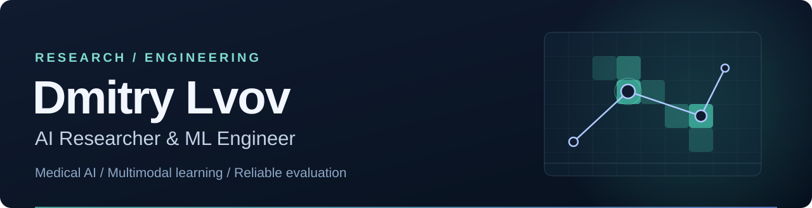

<picture>
  <source media="(prefers-color-scheme: light)" srcset="assets/profile-light.svg">
  
</picture>

Researcher at [Med AI Lab, Innopolis University](https://ilya-pershin.com/lab/).

I work on medical imaging, human attention and the evaluation of clinical models. My first-author papers include LogitGaze-Med at NeurIPS 2025 and SCFR, accepted to NeurIPS 2026. I also work with students on research design, code and experimental results.

## Selected work

### SCFR

Controls how previous examinations affect a new radiology report. SCFR selects among report candidates without using a reference report at inference. The code includes CPU demos and separate fitting, inference and evaluation commands.

 

### LogitGaze

Predicts sequences of eye fixations using transformers and semantic features from vision–language models. LogitGaze-Med applies this approach to medical imaging.

  

### Layout-aware document segmentation

Detects document elements, links figures to captions and generates descriptions with a vision–language model. The resulting document fragments are used for technical question answering.

 

### EHR model selection

A coauthored study of why models with similar overall scores can prioritize different hospital episodes. We compare calibration, retraining stability and which episodes are selected as high risk. Public aggregates can be reproduced without patient records.

 

### Prenatal risk scoreability

Coauthored work on how eligibility rules and referral capacity affect prenatal risk evaluation. The analysis uses CDC Natality data and a fixed model to separate these effects.

### AI Dungeon Master

I contributed to a team project for running Dungeons & Dragons games with LangGraph and LangChain. Eight agents share game state and handle storytelling, world simulation, actions and rules.

## Tools

          

Publication details

- **Source-Causal Control of Historical Context in Longitudinal Radiology Report Generation** — NeurIPS 2026, Main Track, accepted poster. [Paper](https://openreview.net/forum?id=GHvYdC6tmg)
- **From Human Attention to Diagnosis: Semantic Patch-Level Integration of Vision-Language Models in Medical Imaging** — NeurIPS 2025, Main Track. [Proceedings](https://proceedings.nips.cc/paper_files/paper/2025/hash/be7bc8aa38696723cebe296b6122d7e3-Abstract-Conference.html)
- **Enhancing Technical Question Answering Quality Through Multimodal Document Segmentation** — IEEE Access, 2026. [DOI](https://doi.org/10.1109/ACCESS.2026.3655813)
- **Uncertainty Estimation in Cardio Landmark Detection and Heart Disease Diagnosis on Chest X-Ray Images** — IEEE Access, 2025. [DOI](https://doi.org/10.1109/ACCESS.2025.3566772)
- **LogitGaze: Predicting Human Attention Using Semantic Information from Vision-Language Models** — ICLR 2025, Workshop on Reasoning and Planning for Large Language Models. [Paper](https://openreview.net/forum?id=Om4j6IVb42)

