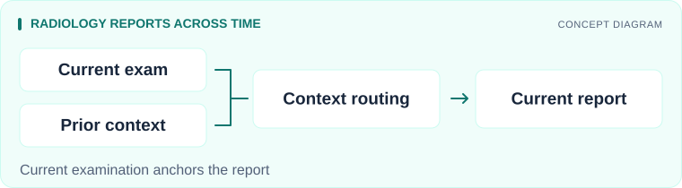
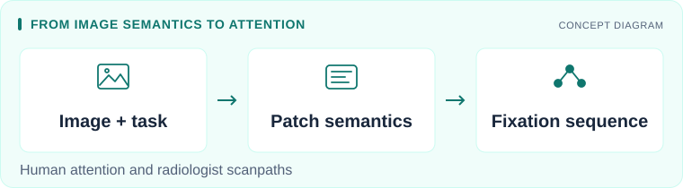
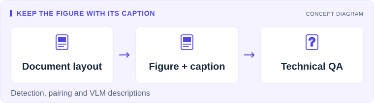
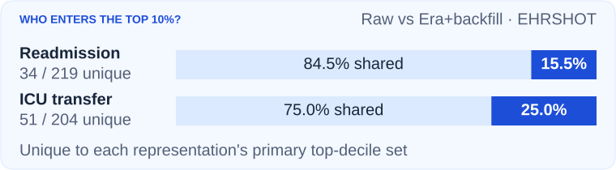
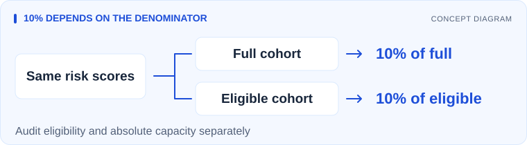
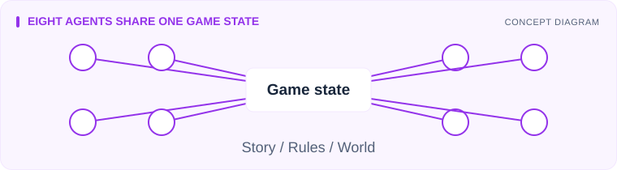

# AI researcher & ML engineer

I build models for medical imaging and human attention at [Med AI Lab, Innopolis University](https://ilya-pershin.com/lab/). I also study how data representation and evaluation choices affect clinical risk assessment.

**First-author papers:** [NeurIPS 2025](https://proceedings.nips.cc/paper_files/paper/2025/hash/be7bc8aa38696723cebe296b6122d7e3-Abstract-Conference.html) · [NeurIPS 2026](https://openreview.net/forum?id=GHvYdC6tmg) (accepted poster) · [IEEE Access 2026](https://doi.org/10.1109/ACCESS.2026.3655813)

## Research & code

### SCFR: using patient history in radiology reports

*First-author paper · NeurIPS 2026 main track, accepted poster*

<picture>
  <source media="(max-width: 600px)" srcset="assets/scfr-mobile.svg">
  
</picture>

A report generator can carry an old finding into a new report. SCFR controls how prior images and reports influence the current description, then selects among reports built from valid sources. Includes a CPU demo and fitting, inference and evaluation commands.

 

### LogitGaze: predicting where people look

*NeurIPS 2025 main track (LogitGaze-Med, first author) · ICLR 2025 workshop (LogitGaze)*

<picture>
  <source media="(max-width: 600px)" srcset="assets/logitgaze-mobile.svg">
  
</picture>

What people look at depends on what they are searching for. LogitGaze uses semantic features from vision-language models to predict sequences of eye fixations. LogitGaze-Med extends this approach to radiologists' attention on chest X-rays.

  

### Document segmentation for technical question answering

*First-author paper · IEEE Access, 2026*

<picture>
  <source media="(max-width: 600px)" srcset="assets/document-qa-mobile.svg">
  
</picture>

Splitting a technical PDF into plain text can separate a figure from its caption. Our pipeline detects document elements, keeps those pairs together and adds descriptions from a vision-language model, making diagrams and other visual elements available for question answering.

 

### Similar scores, different high-risk episodes

*Coauthored paper · TAE 2026 workshop*

<picture>
  <source media="(max-width: 600px)" srcset="assets/ehr-selection-mobile.svg">
  
</picture>

A different representation of the same patient history produced different high-risk episode lists, while differences in aggregate predictive performance remained uncertain. We audit which episodes enter the top decile, going beyond a comparison of overall scores.

Raw history versus Era+backfill on EHRSHOT. Public aggregates: Korobeinikova, Lvov and Pershin. [Figure source and definitions](assets/README.md#ehr-selection-data-figure).

 

### Same top fraction, different workload

*Coauthored paper · TAE 2026 workshop*

<picture>
  <source media="(max-width: 600px)" srcset="assets/prenatal-mobile.svg">
  
</picture>

Selecting the top 10% of a restricted cohort can create a different referral workload from selecting the top 10% of the full population. Our CDC Natality audit holds risk scores fixed and separates eligibility from absolute selection capacity.

 

### AI Dungeon Master: eight agents, one game

*Team project · LangGraph and LangChain*

<picture>
  <source media="(max-width: 600px)" srcset="assets/dungeon-mobile.svg">
  
</picture>

Storytelling, combat rules and world state have to agree during a Dungeons & Dragons session. I contributed to a team prototype in which eight agents share game state and divide those responsibilities.

## Tools

          

I also help students design experiments and review their code and results.

Publication details

- **Source-Causal Control of Historical Context in Longitudinal Radiology Report Generation** (NeurIPS 2026, main track, accepted poster). [Paper](https://openreview.net/forum?id=GHvYdC6tmg)
- **From Human Attention to Diagnosis: Semantic Patch-Level Integration of Vision-Language Models in Medical Imaging** (NeurIPS 2025, main track). [Proceedings](https://proceedings.nips.cc/paper_files/paper/2025/hash/be7bc8aa38696723cebe296b6122d7e3-Abstract-Conference.html)
- **Enhancing Technical Question Answering Quality Through Multimodal Document Segmentation** (IEEE Access, 2026). [DOI](https://doi.org/10.1109/ACCESS.2026.3655813)
- **Uncertainty Estimation in Cardio Landmark Detection and Heart Disease Diagnosis on Chest X-Ray Images** (IEEE Access, 2025). [DOI](https://doi.org/10.1109/ACCESS.2025.3566772)
- **LogitGaze: Predicting Human Attention Using Semantic Information from Vision-Language Models** (ICLR 2025, Workshop on Reasoning and Planning for Large Language Models). [Paper](https://openreview.net/forum?id=Om4j6IVb42)
- **Similar Scores, Different High-Risk Episodes: Auditing Model Selection in Longitudinal EHRs** (TAE workshop, NeurIPS 2026). [Paper](https://openreview.net/forum?id=RffArnWpec)
- **Same Top Fraction, Different Workload: Auditing Eligibility and Capacity in Clinical Risk Evaluation** (TAE 2026 workshop). [Paper](https://openreview.net/forum?id=puYbvC47rw)

